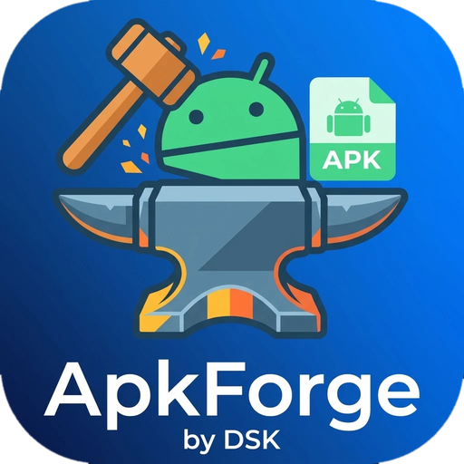

<div align="center">



# ApkForge

### Convierte tu web o tu proyecto HTML en un APK firmado, directamente desde el móvil. Sin Android Studio.

[🇪🇸 Español](README.es.md) · [🇬🇧 English](README.md) · [🌐 GitHub](https://github.com/dskmusic/ApkForge)


[](LICENSE)

[**⬇ Descargar la última versión**](https://github.com/dskmusic/ApkForge/releases/latest/download/ApkForge.apk)

</div>

---

## ✨ Qué hace

- Crea un **APK firmado e instalable** a partir de: un **ZIP/APK**, una **carpeta** o una **web online**.
- Nombre, paquete, versión, icono (propio, favicon de la web o por defecto), orientación, pantalla completa, tema…
- **Instalar**, **Compartir** (uno o varios) o **Guardar como…** desde la lista de APKs generados.
- Todo en el propio dispositivo: sin servidor.

## 📥 Instalación

1. Descarga `ApkForge.apk` de [Releases](https://github.com/dskmusic/ApkForge/releases/latest).
2. Ábrelo y permite «instalar apps desconocidas» para tu navegador o gestor de archivos.

> Las releases oficiales se firman con la **clave de debug de Android** (pública). Sirve para usar y repartir la app, pero no se puede actualizar encima de una compilación firmada con otra clave.

## 🔑 Firma de los APK que generas

- **Por defecto** se usa un keystore de debug público incluido en la app: funciona sin configurar nada.
- **Para publicar tus apps**, importa el tuyo en **⚙ Ajustes → Cambiar keystore…** (`.jks`, `.keystore` o `.p12`), escribe alias y contraseña **una sola vez** y quedan recordados.

## 🛠 Compilar

```bash
git clone https://github.com/dskmusic/ApkForge.git
```

Ábrelo con Android Studio (JDK 17) o ejecuta `./gradlew assembleRelease`.

- **Firmar con tu clave en local:** copia `keystore.properties.example` a `keystore.properties` y rellénalo. Si no existe, se firma con la de debug (es lo que hace GitHub Actions).
- **Tu keystore privado como predeterminado (opcional, solo local):** copia tu archivo a `app/src/main/assets/dskmusic.keystore` (está en `.gitignore`). Si existe, la app lo usa en lugar del de debug.
- **Release en GitHub:** *Actions → Build release APK → Run workflow*. Sube la versión antes en `version.properties`.

## 📄 Licencia

[Apache 2.0](LICENSE) · Conserva el archivo [NOTICE](NOTICE) y menciona a **ApkForge by DSK** si redistribuyes o derivas el proyecto.

Hecho con ❤ por [DSK](https://www.dskmusic.com/dsk_dev_redirect.php)
